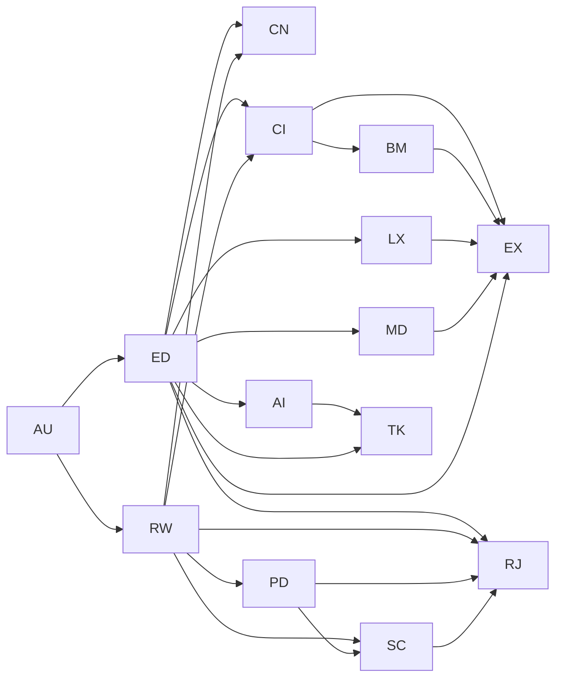

# Ekdotico SRS analysis

Written 2 October 2026. Basis: `Ekdotico/docs`, branch `main`, commit `37c5e8c` (30 September 2026), SRS 1.5.0, 536 requirements (460 FR in 16 modules, 76 NFR in 7 groups; one withdrawn).

**Basis note.** The local `docs` checkout was on a feature branch 44 commits behind `main`, with SRS 1.4.0. It lacked the whole Istorico amendment set. Everything below was read from a read-only `git archive` of `origin/main`. Coverage: every requirement in the 14 modules this application builds, every NFR group, §1, §2.4 and §2.7, the reviewer notes, the changelog, and the design pages (architecture, data models, class diagram, API design, risk register, build phases, tech stack). FR-PR and FR-VR were read only where the rest of the product touches them; they are Istorico's. The references page, the audit folder and `docs/superpowers` were not read.

## 1. Summary

- **Scope after excluding Istorico:** 14 of 16 modules, 360 functional requirements. Twelve are wholly ours (AI, BM, CI, CN, ED, LX, MD, PD, RJ, RW, SC, TK). Two are split with Istorico (AU, EX). The 76 NFRs apply to both products; about eleven are Istorico-led (section 2.2).
- **The seam is the hard part, not the build.** Roughly a dozen requirements in the ours-modules say "emit X to the provenance record". Defined behind one port with a no-op adapter, none of them blocks us. Section 3 lists them.
- **One module genuinely needs Istorico's data:** the research journal's session chronicle (FR-RJ-08, FR-RJ-11) reads provenance session data. This needs a decision (F-02).
- **The most important unanswered question is how the two products meet:** the data-model page puts Istorico's tables in the same Prisma schema as `Document`, and the signer host reads session state from PostgreSQL. That is a shared database, with one migration authority to be chosen (D1).
- **Spec defects found:** 15, none fatal. Four deserve a Docs Amendment before the code that touches them (F-01 to F-04). Section 5.
- **Recommended first slice:** Phase 1 as the docs define it (Clerk, personal workspace, document, Tiptap, Hocuspocus, two users editing, permission model at the API layer), with the port and its no-op adapter in place from day one.

## 2. Scope

### 2.1 What we build

| Module | Reqs | What it is | Needs from others |
|---|---:|---|---|
| FR-AU | 54 | Clerk identity, personal and institutional workspaces, enrolment, permissions, roles, AI policy, thresholds, dashboard access | Split with Istorico (below) |
| FR-ED | 34 | Tiptap block editor, slash palette, Hocuspocus and Yjs collaboration, document roles, comments, sync indicator | AU |
| FR-LX | 19 | LaTeX block, KaTeX, hierarchical equation numbers | ED |
| FR-MD | 18 | Mermaid block, `mmd` rendering, shared figure counter with images | ED |
| FR-CN | 16 | React Flow planning canvas, collaborative through Yjs | ED, RW (source nodes), PD |
| FR-RW | 33 | Five-API parallel search, dedupe, Unpaywall, source library, research workspace assistant (Haiku) | AU (policy) |
| FR-PD | 33 | PDF.js reader, upload, annotations | RW |
| FR-CI | 23 | Citation node, identifier resolution, manual entry, BibTeX and RIS, five styles | ED, RW |
| FR-BM | 10 | Computed bibliography, ordering, Chicago two-section model | CI |
| FR-SC | 30 | Ingestion, pgvector HNSW, three-tier context, Sonnet, chunk citations | RW, PD, OpenAI |
| FR-AI | 24 | Prose Refine, seven focus modes, Apply | ED, CI (context), AU |
| FR-TK | 16 | Task tracker, Haiku extraction, three confidence tiers | ED, AI |
| FR-RJ | 17 | Five-section journal, BullMQ delta jobs, two-layer content | ED, RW, PD, SC, **Istorico** |
| FR-EX | 33 | Pandoc pipeline, four formats, versioning, Revise and Branch | ED, CI, BM, LX, MD, **Istorico** |
| **Total** | **360** | | |

### 2.2 What we leave to Istorico

Istorico's own rules name what it chiefly implements: FR-PR, FR-VR, "the lock and seal parts of FR-EX", FR-AU-19, FR-AU-52, FR-AU-54, and the NFR and §2.7 material on signing, keys, retention and erasure. My reading of the boundary:

- **Not built here:** FR-PR (68), FR-VR (32), FR-AU-19, -52, -54 (and the review-period behaviour of -14, -17, -21, -37, which follows from -19), and the lock and seal halves of FR-EX (FR-EX-03(a) and (d), -04, -05, -18, -19). NFR-SE-09 to -12, -15, -16, NFR-RE-05, -12, -13 and NFR-DP-07, -08 are Istorico-led.
- **Still ours, because they apply to the whole product:** the rest of NFR-SE, NFR-RE, NFR-PE, NFR-SC, NFR-IC, NFR-I18, NFR-DP-01 to -06, and §2.7 for everything that is not a provenance record.
- **Unconfirmed:** the Docs do not state the NFR split. Confirm it with the owner of Istorico before relying on it (D3).

## 3. The Istorico seam

Everything the application owes Istorico, from the requirement text on `main`. "Ours" is what we build; "theirs" is what Istorico builds.

| # | Seam | Ours | Theirs | Requirements |
|---|---|---|---|---|
| S1 | Editor transactions | Tiptap and ProseMirror editor; the qualifying-interaction set (keystrokes, paste, block ops, formatting, citation insertion, AI invocation, inserting slash commands, comment actions, LaTeX and Mermaid code edits); origin marking | Client batching (first-after-lull sent at once, lull marker, maximum age, flush reason), batch UUID and counter, server receipt time | FR-ED-32 to -34, FR-PR-05 to -09 |
| S2 | Session lifecycle | Hocuspocus server and Clerk-authenticated connections | Open on first qualifying interaction; close on tab close, a 60 s disconnect, or 30 min idle; snapshots at open and close | FR-AU-08, FR-PR-02, -03, -11 |
| S3 | Signals from modules | Emit points (Appendix A) | Aggregate, commit, sign | FR-AI-22, FR-RW-33, FR-SC-30, FR-RJ-16, FR-TK-15, FR-PD-33, FR-CN-15, FR-MD-17, FR-LX-14, FR-ED-30, FR-CI-22 |
| S4 | Lock-time document facts | Compute at lock: final word and paragraph counts, citations with source types, research-workspace sources that are cited, canvas node count, Mermaid types and element counts, comment-thread counts | Include in the signed record | FR-AI-22, FR-RW-33, FR-CN-15, FR-MD-17, FR-ED-30, FR-PR-23 |
| S5 | Lock and seal | Export job: stage-one pre-render, Pandoc, fixed-length reserved region, file hash over the signed byte range, write the reference after the seal, deliver, stated error states | Close and sign every session, evaluate thresholds, sign the lock message, sign the seal message, format links | FR-EX-03 to -05, -18, -19, FR-PR-47, NFR-RE-13 |
| S6 | Lineage | Revise and Branch UI, duplicate from the locked Yjs snapshot, collaborator carry-over, version numbers | Predecessor and branch references as salted commitments, genesis, session 1 starts from the inherited snapshot | FR-EX-24 to -31, FR-PR-37a, -37b |
| S7 | Policy and thresholds | AI feature policy and threshold configuration, enforced at the API layer | Policy snapshot in the lock message, flag evaluation, fixed statement | FR-AU-40 to -50, FR-PR-47, -50 |
| S8 | Threshold notification | In-app and email delivery infrastructure, the two opt-in settings | When it fires, what it says | FR-AU-52 |
| S9 | Dashboard | Routes, permissions, review-period window, shell | The three-panel report and text rendering | FR-AU-36 to -39, FR-VR-25 to -27 |
| S10 | Researcher's own report | Page in the document UI | The data and rendering | FR-AU-51 |
| S11 | Erasure | Account deletion, Tier 2 deletion of documents, sources, files | Tier 1 pseudonymisation, event-log deletion, hold for proceedings | NFR-DP-06, §2.7 |
| S12 | Group documents | Create, invite, contributor roles | Recording level (undecided: N1, N2) | FR-AU-54, FR-PR-38 |

**Proposed shape: one port, two adapters.** A single TypeScript interface in the application (signal sink, session hooks, lock and seal, lineage, record reader) with a no-op adapter for development and tests, and an Istorico adapter later. This is the case where an interface with one implementation is justified: two implementations are certain, and the ownership boundary needs a seam. The port must never throw into the editor path; losing a signal must not lose an edit. Names are mine, not the Docs'.

**Not decided, and blocking the matching seam** (from `srs/2-functional-requirements/_notes.md`): N1 and N2 (group-document recording levels, S12), N4 and N5 (LaTeX archive hashing and format-link fields, S5 for sealed LaTeX and Markdown exports), N10 (paste derivation on the server, S1), N11 (AI calls routed through AWS Frankfurt, which would change the Anthropic integration and the processor table). Build around these; do not implement any of them.

## 4. Dependencies and build order

Every path passes through FR-AU and FR-ED, so those lead. FR-EX is last because it consumes five modules and carries the longest-lead infrastructure (Pandoc image, bundled TeX, no-network container), which should be started early in parallel.

The docs' own build phases (`app/implementation/build-phases`) are sound apart from Istorico's content. Adapted:

| Phase | Builds | Differs from the docs |
|---|---|---|
| 1 Foundation | FR-AU (without dashboard report and group documents), FR-ED, Hocuspocus, Prisma subset, Clerk, domico, CI | Add the port and its no-op adapter |
| 2 Blocks | FR-LX, FR-MD, comments (FR-ED-25 to -31) | The docs' phase 2 is provenance; that is Istorico's |
| 3 Research | FR-RW, FR-CI, FR-BM, FR-PD, FR-SC | Exit criterion "signals recorded correctly" becomes "emits the signal to the port" |
| 4 AI | FR-AI, FR-TK, FR-RJ (sections 1 to 4; section 5 behind the port) | As above; see F-02 |
| 5 Export | Draft export in four formats, versioning, FR-CN, sealed export behind the port | "Verify renders three panels" and "signature verification" are Istorico's exit criteria |
| 6 Hardening | §2.4 budgets, GDPR flows on our side, OWASP, browsers, HA failover | Provenance-related load and erasure are Istorico's |

Phase 1 exit criteria are all ours and can be used as written: sign-up creates a personal workspace; create a document; Yjs state persisted; two users edit live; permission model enforced with correct 401 and 403.

## 5. Findings

Severity is my judgement of the cost of discovering it late. "Amend" means the Docs should change before the code that depends on it; "Note" means a record in the build is enough. Verified items were checked against the `main` text.

| ID | Sev | Finding | Action |
|---|---|---|---|
| F-01 | High | **The Ekdotico–Istorico integration contract is undefined.** The data models put `ProvenanceSession`, `EventLogBatch`, `ExportLock`, `Seal` and `KeyRegistryEntry` in one Prisma schema with foreign keys to `Document`; the architecture has the signer host read session state from PostgreSQL. So the products share a database, but no document says who owns the schema and migrations, whether the editor tap ships from us or from Istorico, or how snapshots at session open and close (FR-PR-11) are stored. | Decision D1; then Amend |
| F-02 | High | **FR-RJ section 5 and FR-RJ-11 read provenance data** ("provenance session data (word count delta per session, revision operation counts, AI surface activity)", "the provenance session record for the most recently completed session"). That is a hard read dependency from our module on Istorico's, and on closed sessions that may still be unsigned. | Decision D4; Amend |
| F-03 | High | **Private source chat leaks into a shared journal.** FR-SC-24 makes each user's conversation independent and invisible to others. FR-RJ-07 and FR-RJ-11 summarise source chat into research journal section 4, which every collaborator may view (FR-RJ-02). Likewise FR-PD-25 keeps annotations per user but FR-PD-29 feeds annotated text to the journal. | Amend |
| F-04 | High | **Access revocation cannot reach a live WebSocket.** NFR-SE-03 authenticates a connection once and forbids re-checking per message; FR-AU-27 requires permission changes to take effect on the next request; FR-ED-19/20 define Viewer and Reviewer as non-editing; the review period (FR-AU-19, -37) expires automatically. A removed collaborator or an expired institutional reader keeps a connected session. | Amend: require read-only flag at connect and server-initiated disconnect on change |
| F-05 | Med | **Data model is less complete than the page admits.** Admitted: PDF annotations, source chat history, journal annotations, export job, consent timestamp, notification method. Not admitted: document collaborators and invitations (FR-ED-19 to -21), comment threads, comments, mentions and in-app notifications (FR-ED-25 to -30), workspace invitations, review period, per-user panel state (FR-RW-02, FR-SC-02, FR-PD-02), soft delete (the API says "soft-delete", the model has no `deletedAt`), and the chronicle entries of FR-RJ-08, which accumulate while the model has one string. | Note; model per phase |
| F-06 | Med | **Three inconsistent task models.** FR-TK-01 has title, description, three statuses, source type, confidence and tier, timestamps; the Prisma `Task` has a single `content` and an extra `AMBER` status; the class diagram has "pending / amber / completed / dismissed / silently_logged". Verified. FR-TK-04's deduplication also needs a stored source reference that no model has. | Amend the data model to FR-TK-01 |
| F-07 | Med | **Job inventory is incomplete.** Source ingestion (FR-SC-03) is a BullMQ job but is absent from the job types, the retry table (NFR-RE-11) and the queue-depth table (NFR-PE-10). Verified. Review-period expiry (FR-AU-19, -37), automated erasure (NFR-DP-06) and notification delivery are also unscheduled work. | Amend |
| F-08 | Med | **Glossary contradicts FR-SC.** Glossary: source chat "operates in My Sources mode … and Research mode (open discovery via external APIs)". FR-SC scope: it "does not query external APIs directly". Verified on `main`. | Amend the glossary |
| F-09 | Med | **FR-ED-01 omits the citation node** that FR-CI-01 says FR-ED establishes, and nothing says how comment anchors survive concurrent edits (Yjs relative positions are the obvious answer). Where the canvas lives (same `Y.Doc` or a sibling in the same room) is also unstated: FR-CN-11 says "a Yjs document", FR-CN-12 puts it in the locked snapshot. | Amend FR-ED-01; Note for the rest |
| F-10 | Med | **Export gaps.** SVG-to-PDF conversion is specified for DOCX (FR-EX-13) but not for the PDF path, which also embeds Mermaid SVG (FR-EX-09, -12). Pre-rendering LaTeX with KaTeX to an image (FR-EX-10) produces non-selectable, non-editable equations in PDF and DOCX where Pandoc can emit native math; that is also an accessibility cost. | Decision D6 |
| F-11 | Med | **NFR-IC-04 says "latest stable"; the suite is capped** at TypeScript 6.0.3, ESLint 9.39.5 and Node 24 by peer ranges (measured 5 September, rechecked 13 September; re-measure before use). NFR-IC-04 allows a documented constraint, so record it as an ADR. As of my 18 September check this Mac has no Node 24 (Homebrew had 20, 22 and 26.8.1; no nvm), so every pnpm script warns on `engines`. | Note: ADR-0001; install Node 24 |
| F-12 | Med | **Licence review is owed.** NFR-IC-12 requires review for GPL dependencies; Pandoc is GPL, kept at arm's length in a container, which should be recorded. `mmd`, "the founder's custom npm package", is not in `docs/package.json` or any sibling repository, so its location, version and licence are unconfirmed (NFR-IC-09, -12). | Note; ask |
| F-13 | Low | **Prompt minimisation versus full-document prompts.** NFR-DP-04 says document-wide content is not sent where less suffices; FR-TK-05 sends the full document to Haiku and FR-RJ-11 the full body to Sonnet. Defensible, but it must be argued in the DPIA (NFR-DP-08). | Note |
| F-14 | Low | **Wrong cross-references in FR-RW-14.** "Open source … FR-RW-19 through FR-RW-20" should be FR-RW-17 and -18; "save to workspace … FR-RW-23" should be FR-RW-19 and -21 (FR-RW-23 is the assistant's suggestions). Verified. The build checks that IDs exist, not that they are the right ones. | Amend |
| F-15 | Low | **Smaller inconsistencies.** FR-EX-02 says draft files are "not retained in server-side storage beyond delivery", FR-EX-20 and §2.7 keep them 24 hours (verified). FR-TK-10 records sub-0.50 completion assessments "in the provenance signal", but FR-TK-15 and FR-PR-29 count only extraction, so completion assessments have no defined signal. FR-AI's scope paragraph still says "maximum number of advisor sessions" though FR-AU-47 and FR-AI-24 removed the maximum. | Amend |

Not a defect, but worth knowing: the SRS locks DigitalOcean FRA1 with Node processes, so the Cloudflare-adapter limits in my notes on the sibling apps (a `proxy.ts` cannot build on `@opennextjs/cloudflare`) do not bind us. `proxy.ts` is the intended NFR-SE-02 layer here. The Clerk traps still do: an empty `authorizedParties` silently disables the CSRF check, and v2 tokens carry the organisation under `o.id` (relevant to FR-AU-08 and -10).

## 6. Stack and operation

- **Locked (NFR-IC-01):** Next.js 16 App Router, React 19.2, TypeScript; Tiptap and ProseMirror (Novel fork), Hocuspocus, Yjs; PostgreSQL with pgvector and Prisma; Clerk; BullMQ on Valkey; Anthropic Haiku and Sonnet; OpenAI `text-embedding-3-small`; Pandoc in Docker; DigitalOcean Spaces; DigitalOcean FRA1. Exact pins, no ranges (NFR-IC-08).
- **Suite alignment, to re-measure:** Next 16.3.4, React 19.2.8, TypeScript 6.0.3, ESLint 9.39.5, Node 24, pnpm 10.33.2, zod 4.5.4 as of mid-September.
- **Processes we run:** web (Next.js), collab (Hocuspocus), worker (BullMQ), the Pandoc container, PostgreSQL, Valkey. Istorico adds the reconciler, the signer host and `verify.ekdoti.co`, which NFR-RE-02 requires to be deployable independently.
- **Design system and copy:** the SRS defers to "the Ekdotico Design System" for tokens, palettes, thresholds and layout (FR-ED-04, FR-CN-09, FR-PD-19, FR-RW-06, -13), which is `@ekdotico/domico`. Its Expression Guidelines and copy linter will govern every user-facing string, including the "disabled by institutional policy" label (FR-AU-42). Installing it needs the GitHub Packages credential.
- **Budgets to design for:** keystroke render under 16 ms at P50 and 100 ms at P99; Yjs propagation 150 ms and 400 ms; ten editors per document (NFR-PE-05); 500 concurrent active documents with burst to 1,000; Prisma CRUD 50 ms at P99 and event-log joins 200 ms; 99.5% uptime, RPO 5 minutes, RTO 1 hour.
- **Models:** the SRS fixes the surfaces to Haiku or Sonnet and makes the version a server-side setting (FR-AI-23). Model IDs go in configuration.

## 7. Decisions needed

| # | Decision | Recommendation |
|---|---|---|
| D1 | How the two products share PostgreSQL: who owns the schema and the migrations | One migration authority. Prisma 7 supports a multi-file schema folder: Istorico's models in their own file, migrated from one place. Agree with Istorico's owner before Phase 1 schema work |
| D2 | Repository shape | One package, three entry points (`src/app`, `src/collab`, `src/worker`); split into a workspace only when deployment forces it. The no-monorepo clause in praktico's specification is that app's own and does not bind this one |
| D3 | Whether this repository adopts Istorico's rule set | Drafted in `CLAUDE.md` (docs are the only source, stop and write an amendment request). Delete it if you want a looser regime |
| D4 | How the research journal's chronicle gets session data | Build sections 1 to 4 now; give section 5 a read port with a fallback computed from our own data (word count from Yjs snapshots, our own AI-use counters) and amend FR-RJ-08 to say so |
| D5 | Whether to consume `@ekdotico/amyntico` (secure headers, Clerk verification, route guards) beside domico | Yes for headers and the Clerk guard. Its required peers (Clerk backend 3.x, TypeScript 6) are both satisfiable here; pin whichever amyntico release is current and re-check its changelog |
| D6 | Equations and diagrams in export | Pass LaTeX math to Pandoc natively (native OMML and LaTeX) and keep KaTeX for the editor preview; amend FR-EX-10 |
| D7 | Deployment on DigitalOcean: App Platform for web, droplets for collab and worker | Needs infrastructure input; nothing in Phase 1 depends on it |
| D8 | Node 24 on this machine | Install it (Homebrew carries 20, 22, 26) before the first `pnpm install` |

## Appendix A: emit points the application owes Istorico

| Source | Signal | Requirement |
|---|---|---|
| Editor | Every qualifying ProseMirror transaction, marked with author and origin; paste size; revision operation type | FR-ED-32 to -34, FR-PR-05, -07, -18, -19 |
| Citation engine | Source type (API-resolved or manual) for every citation, fixed at insertion | FR-CI-22, FR-PR-23 |
| Comments | Threads opened, resolved at lock, distinct participants (never content) | FR-ED-30, FR-PR-21 |
| Prose Refine | Advisor sessions opened, distinct selections, focus-mode set, Apply count and characters inserted; paragraph count at lock | FR-AI-17, -22 |
| Research workspace | Queries, sources returned, sources opened, sources cited at lock | FR-RW-33, FR-PR-25 |
| Source chat | Queries, distinct contributing sources, active and enabled | FR-SC-30, FR-PR-33 |
| Research journal | Active state, delta jobs completed | FR-RJ-16, FR-PR-28 |
| Task tracker | Extraction counts per tier (all three, after deduplication) | FR-TK-15, FR-PR-29 |
| PDF reader | Source opened, first annotation created | FR-PD-33, FR-PR-22 |
| Planning canvas | Used, node count at lock, session of first creation | FR-CN-15, FR-PR-30 |
| Mermaid | Types, element counts, session created and last modified | FR-MD-17, FR-PR-31 |
| LaTeX | Character delta and edit count; code-mode keystrokes excluded from pause distribution | FR-LX-13, -14, FR-PR-32 |
| Workspace policy | State of all five AI surfaces at session start | FR-AU-44, FR-PR-24 |
| Any AI invocation | The invoking user, so contributors' use is attributed to them | FR-PR-40 |

No prompt, response, selection, comment, annotation, task or note content is ever emitted. The signal values are counts and sets.
